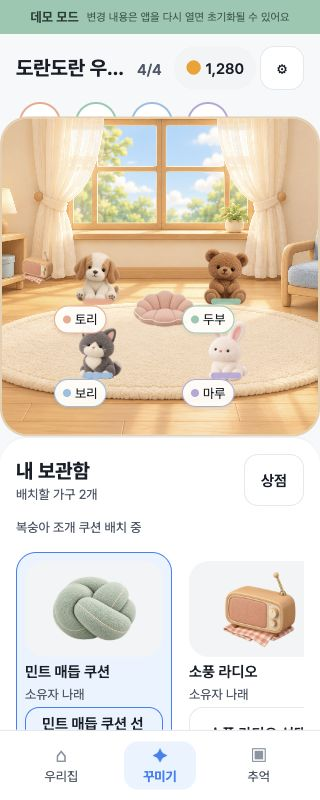
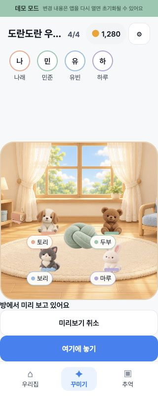
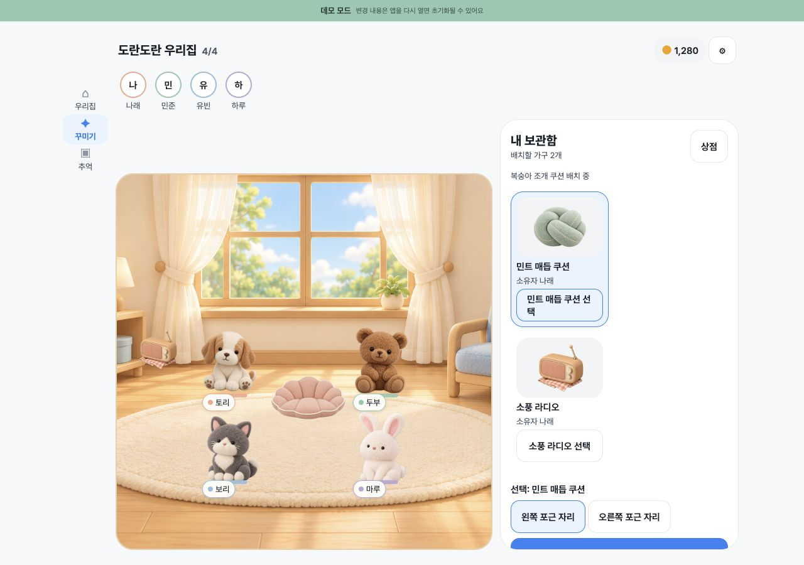
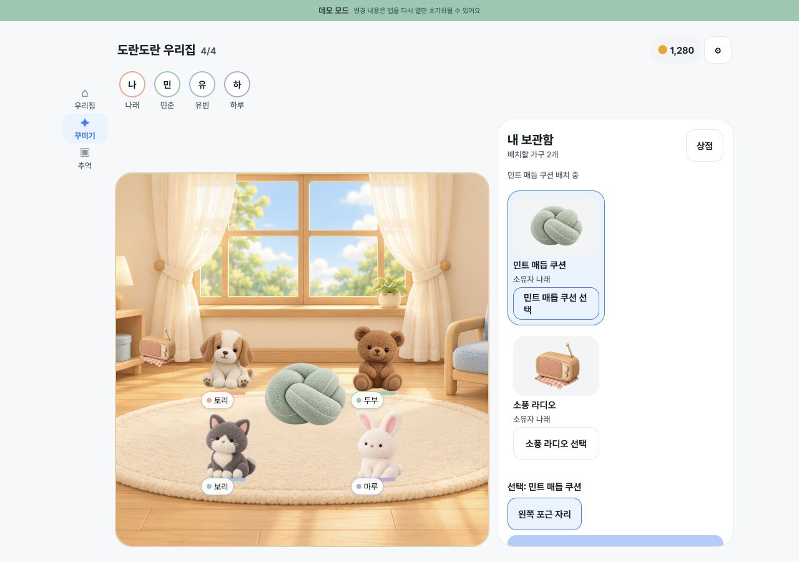

# v3 P0: room rendering and safe furniture preview verification

Date: 2026-10-14 (Asia/Seoul). Base main: `95f031889cdf66bb5c5c94406014c4e7d44faa1f`.
Related: #153, #154, #163. Product direction: **친구와 함께한 시간이 눈에 보이는 집**.
The linked FigJam still includes the older design; the user-approved v3 proposal and issue acceptance criteria guide this PR.

## Scope and preservation

An independent managed Git worktree was created from freshly fetched origin/main. The original dirty checkout was not reset, cleaned, staged or committed. Its 549 tracked/untracked file hashes match the before snapshot; 279 modified/untracked files plus a binary tracked diff were separately backed up. Original branch/HEAD remain intact.

The existing 18-file patch passed `git apply --check`, then applied without manual conflict resolution. Its initial 18/18 hashes matched the manifest. No code was lost or duplicated in the original checkout. Final responsive corrections are limited to the same components: vertical tray scrolling keeps full card controls reachable at 320px; the desktop aside stays fixed-width, and the room square is capped to its measured parent width.

No economy, shop, snack, attendance, habit, asset-source or migration changes. Existing RPC/RLS ownership and expectedVersion remain authoritative. Preview and cancellation change only a local snapshot projection. Confirmation alone calls placeItem. RoomRevision/undo/free furniture and the ongoing #154 contract corrections remain in the original working directory, outside this PR.

## Automated results

| Check | Unpatched main | Final branch |
| --- | --- | --- |
| TypeScript | exit 0 | exit 0 |
| ESLint | exit 0 | exit 0 |
| Jest | 64 suites / 258 tests, all pass | 67 suites / 277 tests, all pass |
| Demo Web build + export verification | not run as baseline | both exit 0 |
| Supabase Web build + export verification | not run as baseline | both exit 0 |

Main's own lockfile was installed with npm ci in this worktree. Explicit command exit codes and Jest JSON success were checked. The existing forceExit/open-handle notice remains; these results do not demonstrate native FPS or long-running timer cleanup.

Test inventory: 20 new assertion names, one existing ownership test renamed and strengthened to require only owned usable choices; net +19 tests. No suites or test-discovery configuration were excluded. [Exact delta](test-delta.json), [machine-readable results](results.json).

New coverage includes every allowed slot for all 35 shop decorations at 320/1280, actor/furniture foot-depth, legacy duplicate suppression, parent-contained 44pt memory targets, immutable preview/cancel, captured version conflict after snapshot refresh, network failure, repeated pending confirmation, malformed/missing joined slot data and query failures, and a desktop parent-width cap. Existing offline and friend-ownership tests still run.

## Actual browser verification (Demo only)

CUA on localhost Demo port 8083, separate from the user's original port 8081:

- 320×800: card selections reachable, including the radio; mint cushion preview replaces the peach picture; cancellation restores peach; page document remains 320×800 with internal inventory scroll.
- 1280×900: room and inventory no longer overlap; card/slot/action controls reachable; explicit confirmation shows mint in the confirmed scene.
- Home→Decorate navigation retains the confirmed mint placement in the same Demo repository instance.
- Reload resets the scene to peach. **The requested reload-persistence criterion is not met in Demo.** This is the preexisting in-memory D-003 contract and banner, not a new regression. Persistence was not silently added to this focused PR.

These are developer-driven browser observations, not a human fun/usability study. Unit layout coverage is distinguished from screenshots and actual physical touch testing.

## Server and device limits

Supabase tests replace only the external Data API/RPC client; mapping, choices and error contracts run as application code. Supabase mode Web export is a compile/configuration check, not authenticated server gameplay. No isolated test project/A/B credentials were supplied; production DB writes and remote deployments were not performed.

Unverified: actual A/B simultaneous edits, cross-account visibility, server logout/reconnect and refresh persistence, left-house access denial, iOS/Android devices, assistive technologies and physical hit behavior. Existing SQL/RLS suite was not run in this worktree because a local Supabase/Postgres/Docker runtime is unavailable. No related GitHub issues are closed by this PR.

## Remaining issue gates

- #153: actual server reconnection/full-slot visibility and native/assistive validation remain.
- #163: actual server A/B collision and persistence, native interaction and user understanding of cancellation remain. This main-based PR closes the inline inventory during preview; it does not port the original dirty checkout's modal redesign.
- #154: movement between occupied slots, removal, undo, room-level command idempotency, conflict comparison and griefing controls remain separate. Existing local code/server files must be preserved and reconciled before its next PR.

Safe next work: a separate #154 worktree based on this branch with local contract tests. Do not merge this PR automatically or treat server/device gates as passed. Do not mix the broader dirty checkout into this branch.
